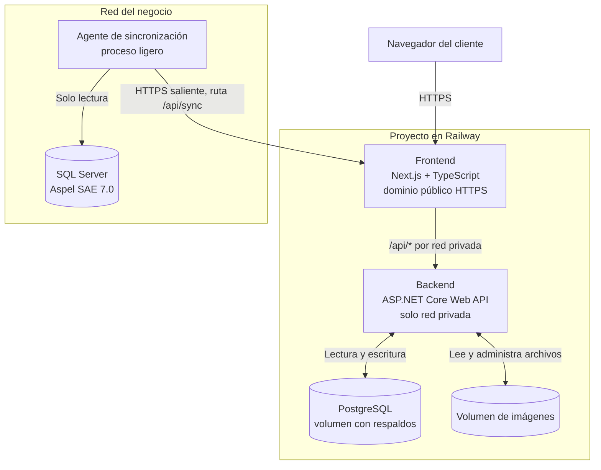
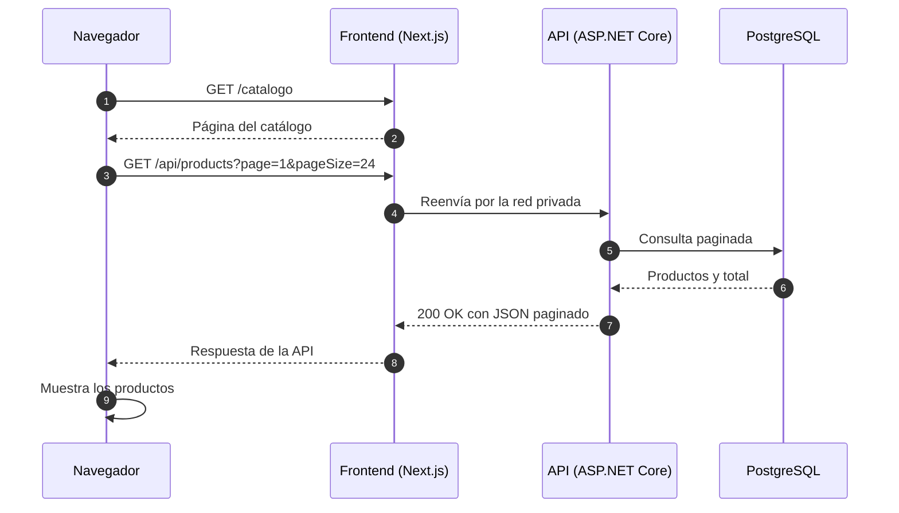
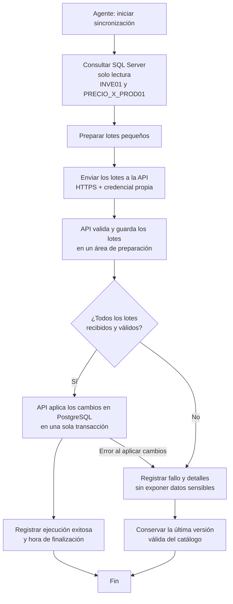

# Arquitectura técnica

**Catálogo Web – Mini Super Nettes**  

## 1. Visión general

La solución separa la interfaz web, la API del backend y las bases de datos. El navegador nunca se conecta directamente a una base de datos. Frontend, backend y PostgreSQL se ejecutan como servicios de un mismo proyecto en Railway. Solo el frontend tiene dominio público: recibe las páginas y reenvía las solicitudes `/api/*` al backend por la red privada de Railway.

Aspel SAE permanece en la red del negocio y **no se expone a Internet**. Un agente de sincronización, que corre en esa red, lee SQL Server en modo de solo lectura y envía los datos a la API mediante conexiones HTTPS salientes.

**Flujo previsto:** el navegador solo conoce un dominio, el del frontend. Next.js sirve las páginas y reenvía las solicitudes bajo `/api/*` al backend usando su dirección interna (`<servicio>.railway.internal`). Así el backend no necesita dominio público y las cookies de sesión pertenecen a un único sitio. El agente de sincronización usa esa misma entrada pública, en una ruta protegida con su propia credencial.

## 2. Componentes y responsabilidades

| Componente               | Tecnología                                                  | Dónde corre                                           | Responsabilidad                                                                                                                      |
| ------------------------ | ----------------------------------------------------------- | ----------------------------------------------------- | ------------------------------------------------------------------------------------------------------------------------------------ |
| Frontend                 | Next.js con TypeScript                                      | Servicio en Railway (dominio público)                 | Interfaz pública del catálogo y panel administrativo. Consume la API y no se conecta directamente a las bases de datos.              |
| Backend                  | ASP.NET Core Web API (.NET 10, C#)                          | Servicio en Railway (red privada)                     | Lógica de negocio, autenticación, autorización, recepción de la sincronización y acceso a la base de datos y a los archivos.         |
| Base de la aplicación    | PostgreSQL 17 con Entity Framework Core y Npgsql            | Servicio de base de datos en Railway                  | Usuarios, roles, favoritos, metadatos de imágenes, contenido del sitio y copia sincronizada de productos.                            |
| Sistema de origen        | Aspel SAE 7.0 sobre SQL Server                              | Red del negocio                                       | Fuente oficial de códigos, descripciones, precios y existencias. Solo se consulta.                                                   |
| Agente de sincronización | Proceso programado (por ejemplo, un Worker Service de .NET) | Máquina de la red del negocio con acceso a SQL Server | Lee SQL Server con una cuenta de solo lectura y envía los datos a la API. No recibe conexiones entrantes.                            |
| Imágenes                 | Archivos en un volumen de Railway                           | Volumen montado en el backend                         | Los archivos viven en el volumen; sus rutas y metadatos se registran en PostgreSQL. El acceso se gestiona a través de la aplicación. |
| HTTPS y dominio          | Dominio de Railway o dominio propio                         | Plataforma                                            | Railway emite y gestiona el certificado HTTPS del dominio público.                                                                   |

## 3. Separación de datos

| Dato                                        | Dónde vive                                       | Quién lo escribe                         |
| ------------------------------------------- | ------------------------------------------------ | ---------------------------------------- |
| Productos, precios y existencias originales | SQL Server de Aspel SAE (red del negocio)        | Aspel SAE; la aplicación solo lee.       |
| Copia de productos para el catálogo         | PostgreSQL (`products`)                          | Únicamente el proceso de sincronización. |
| Usuarios, roles y hashes de contraseñas     | PostgreSQL (ASP.NET Core Identity)               | Backend.                                 |
| Favoritos                                   | PostgreSQL (`favorites`)                         | Backend, por usuario.                    |
| Metadatos de imágenes de productos          | PostgreSQL (`product_images`)                    | Administradores mediante el backend.     |
| Archivos de imágenes                        | Volumen de Railway                               | Administradores mediante el backend.     |
| Contenido del sitio y productos destacados  | PostgreSQL (`site_content`, `featured_products`) | Administradores mediante el backend.     |
| Registro de sincronizaciones                | PostgreSQL                                       | Backend, al recibir la sincronización.   |

Reglas:

- **SQL Server es la fuente oficial** de productos, precios y existencias. La aplicación nunca modifica esos datos.
- **Aspel SAE no se expone a Internet.** Solo el agente, desde la red del negocio, lo consulta.
- Las consultas públicas se realizan sobre la copia de PostgreSQL, no directamente sobre Aspel SAE.
- La copia de productos solo se modifica mediante la sincronización. Ni usuarios ni administradores editan los precios o las existencias desde el sitio.
- Las imágenes se almacenan como archivos; PostgreSQL conserva sus rutas y metadatos, no los archivos binarios.

## 4. Flujo de solicitudes del catálogo

El siguiente diagrama representa el flujo previsto. El navegador habla siempre con el frontend; las solicitudes `/api/*` se reenvían al backend por la red privada de Railway.

El listado siempre es paginado: la API no devuelve los aproximadamente 18.000 productos en una sola respuesta. Los parámetros `page` y `pageSize` controlan la página solicitada y el tamaño del listado.

Si durante la implementación se decide que Next.js consulte la API desde el servidor para renderizar páginas, se actualizará el diagrama para reflejar ese flujo adicional.

## 5. Flujo de sincronización con Aspel SAE

**Propuesta.** Como el backend ya no está en la red del negocio, no se conecta a SQL Server. La sincronización la inicia el **agente**, que lee SQL Server con una cuenta de solo lectura y envía los datos a la API por HTTPS, en lotes pequeños. El backend valida los datos y los aplica a PostgreSQL de manera consistente.

Reglas iniciales propuestas:

- **Conexión solo saliente:** el agente inicia todas las conexiones. No se abre ningún puerto de SQL Server ni de la red del negocio hacia Internet.
- **Credencial propia:** el agente se autentica con una clave dedicada a la sincronización, distinta de las cuentas de usuario. Se guarda como secreto, se puede rotar y se transmite solo por HTTPS. La ruta de sincronización rechaza cualquier otra credencial.
- **Frecuencia inicial:** cada 5 a 10 minutos, sujeta a validación con el negocio y a pruebas de carga.
- **Una sola ejecución a la vez:** evitar que se solapen dos sincronizaciones.
- **Lotes pequeños e idempotentes:** reintentar un lote no debe duplicar productos (actualización por código de producto).
- **Aplicación consistente:** el catálogo solo cambia cuando todos los lotes se recibieron y validaron, y se aplican en una transacción. Un error no deja el catálogo parcialmente actualizado.
- **Conservar datos válidos:** si la lectura, el envío, la validación o la aplicación falla, se registra el error y se conserva la última versión válida del catálogo.
- **Registro de ejecución:** guardar inicio, fin, resultado y, cuando sea posible, la cantidad de registros procesados y un resumen del error.
- **Última sincronización exitosa:** la fecha se mostrará al usuario (US-12). Si el agente deja de reportar, el sitio mostrará el aviso de datos desactualizados.
- **Permisos mínimos:** la conexión a SQL Server usa una cuenta con permisos de solo lectura.

La estrategia concreta (área de preparación, tamaño de lote, formato del mensaje) se definirá durante la implementación.

Las tablas y los campos de Aspel SAE (`INVE01`, `PRECIO_X_PROD01`, `STATUS`, `CVE_PRECIO = 1`) están pendientes de validación con el negocio en US-04.

**Alternativas descartadas:**

| Alternativa                                                    | Motivo                                                                                                                           |
| -------------------------------------------------------------- | -------------------------------------------------------------------------------------------------------------------------------- |
| Que el backend en Railway se conecte directamente a SQL Server | Exigiría exponer SQL Server a Internet, aunque se limite por IP. Contradice el objetivo de no exponer puertos de bases de datos. |
| VPN o túnel entre Railway y la red del negocio                 | Funciona, pero añade configuración de red y software en ambos lados, y más puntos de fallo.                                      |

## 6. Autenticación y autorización

**Propuesta:**

- **Identidad:** ASP.NET Core Identity con PostgreSQL. Las contraseñas se guardan mediante hash, nunca en texto plano.
- **Sesión:** se prefiere evaluar cookies seguras (`HttpOnly`, `Secure`, `SameSite`). Como el navegador solo habla con el dominio del frontend y Next.js reenvía `/api/*`, frontend y API comparten sitio. Si se utilizan cookies, se debe proteger contra CSRF.
- **Dominio:** los dominios gratuitos `*.up.railway.app` son adecuados para pruebas; para la entrega conviene un dominio propio del negocio.
- **Alternativa:** tokens JWT. Solo se elegirán si la arquitectura final lo justifica. Si se adopta esta alternativa, la configuración se documentará mediante variables de entorno y no se subirán secretos al repositorio.
- **Roles:** `User` y `Admin`.
- **Autorización:** se verifica siempre en el backend, no solo en la interfaz. Sin sesión válida: `401`; sin permiso: `403`.
- **Primera cuenta administradora:** se crea mediante un proceso controlado (semilla o comando), nunca mediante un registro público.
- **Agente de sincronización:** usa su propia credencial (sección 5) y no tiene sesión de usuario ni rol `Admin`.

La decisión final entre cookies y tokens se toma en US-13.

### 6.1 Protección contra tráfico masivo y Rate Limiting

Para prevenir ataques de denegación de servicio (DoS), consumo desmedido de recursos en Railway y *scraping* automatizado de los 18.000 productos:

- **Middleware nativo de ASP.NET Core:** Se configura un límite global por dirección IP de **100 peticiones/minuto**.
- **Protección del Catálogo (`CatalogSearchPolicy`):** Las rutas de consulta y búsqueda `/api/products` se restringen a un tope de **30 peticiones/minuto por IP**.
- **Agente de Sincronización:** La ruta `/api/sync` estará excluida del limiter público y usará una política dedicada basada en la credencial propia del agente.
- **Capa de Proxy (Cloudflare):** Se recomienda usar Cloudflare (Plan Gratuito) como DNS/Proxy frente a Railway para filtrar bots maliciosos y almacenar en caché imágenes y recursos estáticos antes de que lleguen a los servidores.

---

## 7. Riesgos de despliegue en Railway

| Riesgo                                                                                                 | Mitigación                                                                                                                                                                                                                                         |
| ------------------------------------------------------------------------------------------------------ | -------------------------------------------------------------------------------------------------------------------------------------------------------------------------------------------------------------------------------------------------- |
| Costo: Railway cobra por uso y, tras el crédito de prueba, requiere un plan de pago                    | Definir quién paga, revisar los precios vigentes, configurar alertas o límites de uso y estimar el consumo antes de la Semana 9.                                                                                                                   |
| Método de pago internacional y titularidad de la cuenta                                                | Confirmar con anticipación quién abre la cuenta y cómo se paga; acordar cómo se traspasa el proyecto al negocio al terminar.                                                                                                                       |
| Datos de usuarios (correos, hashes de contraseña) alojados en un proveedor externo                     | Informar al negocio y al docente, guardar solo los datos necesarios y mantener las contraseñas con hash.                                                                                                                                           |
| El agente depende de una máquina del negocio que debe estar encendida                                  | Instalarlo como servicio con inicio automático, mostrar el aviso de datos desactualizados (US-12) y documentar cómo reiniciarlo.                                                                                                                   |
| Robo o filtración de la credencial de sincronización                                                   | Guardarla como secreto, rotarla, limitar el tamaño de lote y validar los datos recibidos.                                                                                                                                                          |
| Pérdida de datos                                                                                       | Activar los respaldos programados del volumen de PostgreSQL y de imágenes, y mantener además un `pg_dump` periódico guardado fuera de Railway (US-20). Los respaldos de volumen viven en el mismo proyecto: no protegen contra borrar el proyecto. |
| Almacenamiento de imágenes limitado por el plan y por el volumen                                       | Estimar el tamaño de las imágenes, limitar el tamaño de carga y verificar los límites del proxy de Next.js al subir archivos (US-16).                                                                                                              |
| El sistema de archivos de los contenedores no es persistente                                           | Guardar todo lo que deba conservarse solo en volúmenes.                                                                                                                                                                                            |
| .NET requiere un `Dockerfile` en Railway; el servicio debe escuchar en `0.0.0.0` y en el puerto `PORT` | Incluir el `Dockerfile` del backend y configurar `ASPNETCORE_URLS`; probar el despliegue temprano.                                                                                                                                                 |
| Exposición accidental de PostgreSQL                                                                    | No habilitar el proxy TCP público de la base de datos; el acceso es por la red privada.                                                                                                                                                            |
| Latencia desde Honduras                                                                                | Elegir la región de Railway más cercana disponible.                                                                                                                                                                                                |
| Disponibilidad de la plataforma y cambios de precios o planes                                          | Documentar cómo reconstruir el entorno y mantener los respaldos fuera de Railway.                                                                                                                                                                  |
| Acceso del equipo al proyecto de Railway                                                               | Verificar si el plan permite invitar al otro integrante; documentar quién tiene acceso.                                                                                                                                                            |
| El agente no debe afectar a Aspel SAE                                                                  | Consultas de solo lectura, ligeras y con intervalo moderado.                                                                                                                                                                                       |

## 8. Convenciones

**Propuestas iniciales**, a confirmar entre los integrantes.

### Nombres

| Elemento                        | Convención                                        | Ejemplo                             |
| ------------------------------- | ------------------------------------------------- | ----------------------------------- |
| Clases y métodos en C#          | PascalCase                                        | `ProductsController`                |
| Tablas y columnas en PostgreSQL | `snake_case`, tablas en plural cuando corresponda | `product_images`                    |
| JSON de la API                  | camelCase                                         | `productCode`                       |
| Rutas de la API                 | Minúsculas, sustantivos en plural                 | `/api/products/{code}`              |
| Componentes de React            | PascalCase                                        | `ProductCard`                       |
| Ramas de funcionalidades        | `feature/<issue>-<descripcion>`                   | `feature/20-catalogo-publico`       |
| Ramas de corrección             | `fix/<issue>-<descripcion>`                       | `fix/23-error-filtro-productos`     |
| Ramas de documentación          | `docs/<issue>-<descripcion>`                      | `docs/30-documentar-instalacion`    |
| Ramas de mantenimiento          | `chore/<issue>-<descripcion>`                     | `chore/10-setup-entorno`            |
| Commits                         | Conventional Commits, en inglés                   | `feat(catalog): add product search` |

Los nombres de ramas y los mensajes de commit se escribirán en inglés, en minúsculas cuando corresponda y usando guiones para separar palabras en las ramas. Los títulos, descripciones y criterios de aceptación de las Issues pueden permanecer en español.

### Respuestas HTTP

| Código                      | Cuándo                                                                                                    |
| --------------------------- | --------------------------------------------------------------------------------------------------------- |
| `200 OK`                    | Consulta o actualización correcta con respuesta.                                                          |
| `201 Created`               | Recurso creado correctamente.                                                                             |
| `204 No Content`            | Operación correcta sin cuerpo (por ejemplo, quitar un favorito).                                          |
| `400 Bad Request`           | Datos de entrada inválidos.                                                                               |
| `401 Unauthorized`          | No hay sesión válida.                                                                                     |
| `403 Forbidden`             | Hay sesión, pero no permiso suficiente.                                                                   |
| `404 Not Found`             | El recurso no existe.                                                                                     |
| `409 Conflict`              | Conflicto con el estado actual (por ejemplo, un favorito duplicado, si la API define ese comportamiento). |
| `429 Too Many Requests`     | El cliente superó la cantidad de peticiones permitidas por minuto (Rate Limit excede la política activa). |
| `500 Internal Server Error` | Error inesperado, sin detalles internos en la respuesta.                                                  |

- Los errores usarán el formato estándar `ProblemDetails`.
- Las respuestas nunca incluirán credenciales, cadenas de conexión ni trazas internas.
- Los listados usarán paginación con `page` y `pageSize`, y devolverán `items`, `page`, `pageSize` y `totalCount`.

## 9. Decisiones registradas

| Decisión                                                             | Motivo / estado                                                                              |
| -------------------------------------------------------------------- | -------------------------------------------------------------------------------------------- |
| .NET 10 (LTS) para el backend                                        | Versión objetivo del proyecto; verificar disponibilidad y soporte antes del despliegue.      |
| Hospedar frontend, backend y PostgreSQL en Railway (**propuesta**)   | No cargar la máquina virtual del negocio. Requiere confirmación del docente y del negocio.   |
| Agente de sincronización en la red del negocio (**propuesta**)       | Mantener Aspel SAE fuera de Internet. Solo hace conexiones salientes.                        |
| Backend sin dominio público; solo el frontend es público             | Un único punto de entrada y cookies de un solo sitio.                                        |
| PostgreSQL 17                                                        | Mantener la misma versión mayor en desarrollo y producción; confirmar que Railway la ofrece. |
| Docker Compose solo para desarrollo                                  | Se utiliza para levantar PostgreSQL localmente.                                              |
| Secretos con User Secrets (local) y variables del servicio (Railway) | No guardar credenciales en el repositorio.                                                   |
| Merge con squash y revisión del otro integrante                      | Mantener un historial de `main` claro y revisar los cambios antes de integrarlos.            |
| Sincronización periódica con Aspel SAE                               | Evitar que las consultas públicas dependan directamente de SQL Server.                       |

## 10. Pendientes

- **Confirmar con el docente y el negocio** el uso de Railway en lugar de la máquina virtual con Windows 11.
- Definir quién abre y paga la cuenta de Railway, y cómo se traspasa al terminar.
- Confirmar con el negocio que se puede instalar un agente en su red, con salida HTTPS a Internet.
- Reglas de Aspel SAE: estado de productos, disponibilidad, precio público y categorías (US-04).
- Definir y probar la estrategia de sincronización por lotes (US-05 a US-07).
- Definir la política de reintentos (*Exponential Backoff*) y detección de inactividad del agente local (*Heartbeat*).
- Configurar las políticas de *Rate Limiting* (`CatalogSearchPolicy`) en la API de .NET.
- Configurar Cloudflare (plan gratuito) en el dominio público para la caché de imágenes y filtrado de bots.
- Validar la integración del proxy de Next.js para reenviar la cabecera `X-Forwarded-For` a la API para identificar las IP reales de los clientes.
- Sesión con cookies o tokens (US-13).
- Reglas de carga de imágenes, tamaño del volumen y límites del proxy (US-16).
- Respaldos de Railway y copia externa con `pg_dump` (US-20).
- `Dockerfile` del backend, servicios de Railway, variables, dominio y HTTPS (US-21).
- Confirmar la región de Railway y la versión de PostgreSQL.
