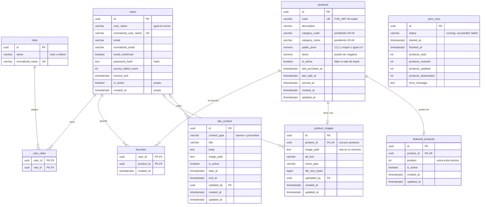

# Esquema de base de datos (PostgreSQL)

**Catálogo Web – Mini Super Nettes**  
Documento de la historia **US-03: Diseñar el esquema de PostgreSQL**.

> Los campos marcados como **pendiente US-04** dependen de reglas de Aspel SAE que se validan con el negocio. El esquema se ajustará con una migración si esas reglas cambian algo.

## 1. Decisiones de diseño

| Tema | Decisión |
|---|---|
| Usuarios | ASP.NET Core Identity, con llaves `uuid` y tablas en `snake_case` (`users`, `roles`, `user_roles`…) |
| Llave de `products` | Llave propia `uuid`; `code` (el código de artículo de Aspel) es único |
| Productos que dejan de venir de Aspel | Se conservan con `is_active = false`; no se borran |
| Imágenes | Una sola imagen por producto; reemplazarla actualiza la misma fila |
| Contenido del sitio | Dos tipos: `banner` y `promotion` |
| Datos de registro | Solo correo y contraseña (sin nombre) |
| Nombres | Tablas en plural y columnas en `snake_case` |
| Fechas | `timestamptz`, guardadas en UTC |
| Estados y tipos | Texto con restricción `CHECK` (no enums nativos de PostgreSQL), para facilitar las migraciones |

## 2. Diagrama de relaciones



`sync_runs` no se relaciona con otras tablas: es un registro independiente. El diagrama omite las tablas de apoyo de Identity (`user_claims`, `role_claims`, `user_logins`, `user_tokens`) y algunas columnas internas de `users`; el modelo completo está en [`database-schema.dbml`](database-schema.dbml), que se puede abrir en dbdiagram.io.

## 3. Tablas de ASP.NET Core Identity

Las gestiona Identity y se crean con la migración inicial. Se renombran a `snake_case` y usan `uuid` como llave.

| Tabla | Contenido |
|---|---|
| `users` | Cuentas de usuario |
| `roles` | Roles (`User` y `Admin`) |
| `user_roles` | Relación usuario-rol |
| `user_claims`, `role_claims`, `user_logins`, `user_tokens` | Tablas de apoyo de Identity (se crean aunque no se usen todas) |

Según la versión de Identity, la migración puede incluir tablas adicionales (por ejemplo, para llaves de acceso); se revisan al generarla.

### `users`

| Columna | Tipo | Notas |
|---|---|---|
| `id` | `uuid` | Llave primaria |
| `user_name` | `varchar(256)` | Igual al correo |
| `normalized_user_name` | `varchar(256)` | Índice único |
| `email` | `varchar(256)` | |
| `normalized_email` | `varchar(256)` | Índice |
| `email_confirmed` | `boolean` | |
| `password_hash` | `text` | Hash; nunca la contraseña |
| `security_stamp`, `concurrency_stamp` | `text` | Los usa Identity |
| `phone_number`, `phone_number_confirmed`, `two_factor_enabled` | | Campos estándar; no se usan en el proyecto |
| `lockout_end`, `lockout_enabled`, `access_failed_count` | | Bloqueo tras intentos fallidos |
| `is_active` | `boolean` | Campo propio. Por defecto `true` |
| `created_at` | `timestamptz` | Campo propio |

El registro solo pide correo y contraseña. No se guarda nombre.

### `roles`

Roles iniciales sembrados en la migración: `User` y `Admin`. La primera cuenta administradora **no** se crea aquí; se hace con un proceso controlado (ver `architecture.md`).

## 4. Tablas del proyecto

### `products`

Copia sincronizada del catálogo de Aspel SAE. Solo la modifica el proceso de sincronización.

| Columna | Tipo | Restricciones / notas |
|---|---|---|
| `id` | `uuid` | Llave primaria |
| `code` | `varchar(50)` | `NOT NULL`, **único**. Viene de Aspel (`CVE_ART`) |
| `description` | `varchar(255)` | `NOT NULL` |
| `category_code` | `varchar(50)` | Puede ser nulo. **Pendiente US-04** |
| `category_name` | `varchar(150)` | Puede ser nulo. **Pendiente US-04** (cómo obtener el nombre) |
| `public_price` | `numeric(12,2)` | `NOT NULL`, `CHECK (public_price >= 0)`. Precio con `CVE_PRECIO = 1`. **Pendiente US-04** |
| `stock` | `numeric(14,4)` | `NOT NULL`. Sin `CHECK`: Aspel puede reportar existencias negativas |
| `is_active` | `boolean` | `NOT NULL`, por defecto `true`. Qué valor de `STATUS` es "inactivo": **pendiente US-04** |
| `last_purchase_at` | `timestamptz` | Opcional. **Pendiente US-04** (decidir si se usa) |
| `last_sale_at` | `timestamptz` | Opcional. **Pendiente US-04** (decidir si se usa) |
| `synced_at` | `timestamptz` | `NOT NULL`. Última vez que se sincronizó |
| `created_at`, `updated_at` | `timestamptz` | `NOT NULL` |

Índices iniciales:

- Único sobre `code`.
- `(is_active, category_code)`, para los filtros del catálogo.
- GIN con `pg_trgm` sobre `description`, para la búsqueda por nombre. Hay que confirmar que la extensión esté disponible en la base de datos de Railway.

Disponibilidad: se propone `is_active = true` y `stock > 0`. La regla final se confirma en US-04.

### `favorites`

| Columna | Tipo | Restricciones / notas |
|---|---|---|
| `user_id` | `uuid` | FK a `users(id)`, `ON DELETE CASCADE` |
| `product_id` | `uuid` | FK a `products(id)`, `ON DELETE RESTRICT` |
| `created_at` | `timestamptz` | `NOT NULL` |

Llave primaria compuesta `(user_id, product_id)`: impide duplicados. Índice sobre `product_id`.

### `product_images`

| Columna | Tipo | Restricciones / notas |
|---|---|---|
| `id` | `uuid` | Llave primaria |
| `product_id` | `uuid` | `NOT NULL`, **único**, FK a `products(id)`, `ON DELETE CASCADE` |
| `image_path` | `text` | `NOT NULL`. Ruta del archivo en el volumen |
| `alt_text` | `varchar(255)` | Texto alternativo |
| `mime_type` | `varchar(100)` | `NOT NULL` |
| `file_size_bytes` | `bigint` | `NOT NULL`, `CHECK (file_size_bytes > 0)` |
| `uploaded_by` | `uuid` | FK a `users(id)`, `ON DELETE SET NULL` |
| `created_at`, `updated_at` | `timestamptz` | `NOT NULL` |

El archivo vive en el volumen de Railway; la base solo guarda la ruta y los metadatos.

### `featured_products`

| Columna | Tipo | Restricciones / notas |
|---|---|---|
| `id` | `uuid` | Llave primaria |
| `product_id` | `uuid` | `NOT NULL`, **único**, FK a `products(id)`, `ON DELETE CASCADE` |
| `position` | `integer` | `NOT NULL`, `CHECK (position >= 1)` |
| `is_active` | `boolean` | `NOT NULL`, por defecto `true` |
| `created_at`, `updated_at` | `timestamptz` | `NOT NULL` |

Índice único parcial sobre `position` donde `is_active = true`, para que dos destacados activos no compartan posición.

### `site_content`

| Columna | Tipo | Restricciones / notas |
|---|---|---|
| `id` | `uuid` | Llave primaria |
| `content_type` | `varchar(50)` | `NOT NULL`, `CHECK (content_type IN ('banner', 'promotion'))` |
| `title` | `varchar(200)` | `NOT NULL` |
| `body` | `text` | Texto de la promoción |
| `image_path` | `text` | Ruta de la imagen |
| `is_active` | `boolean` | `NOT NULL`, por defecto `true` |
| `start_at`, `end_at` | `timestamptz` | Vigencia. `CHECK (end_at IS NULL OR start_at IS NULL OR end_at > start_at)` |
| `updated_by` | `uuid` | FK a `users(id)`, `ON DELETE SET NULL` |
| `created_at`, `updated_at` | `timestamptz` | `NOT NULL` |

Índice sobre `(is_active, content_type, start_at, end_at)`. Qué campos son obligatorios según el tipo (por ejemplo, la vigencia de una promoción) se valida en el backend.

### `sync_runs`

Un registro por ejecución de la sincronización.

| Columna | Tipo | Restricciones / notas |
|---|---|---|
| `id` | `uuid` | Llave primaria |
| `status` | `varchar(20)` | `NOT NULL`, `CHECK (status IN ('running', 'succeeded', 'failed'))` |
| `started_at` | `timestamptz` | `NOT NULL` |
| `finished_at` | `timestamptz` | `CHECK (finished_at IS NULL OR finished_at >= started_at)` |
| `products_read` | `integer` | `NOT NULL`, por defecto 0 |
| `products_inserted` | `integer` | `NOT NULL`, por defecto 0 |
| `products_updated` | `integer` | `NOT NULL`, por defecto 0 |
| `products_deactivated` | `integer` | `NOT NULL`, por defecto 0. Productos que pasan a `is_active = false` |
| `error_message` | `text` | Resumen del error, sin datos sensibles |

Índices:

- Único parcial sobre `status` donde `status = 'running'`: la base impide dos sincronizaciones en ejecución a la vez.
- `(status, finished_at DESC)`, para obtener la última sincronización exitosa (US-12).

## 5. Fuera de este esquema

El área de preparación de los lotes de sincronización se define en US-06 y US-07, cuando se implemente el endpoint que los recibe. Si requiere tablas, se agregan con una migración propia.

## 6. Implementación con Entity Framework Core

### Código

| Archivo | Contenido |
|---|---|
| `backend/Data/AppDbContext.cs` | Hereda de `IdentityDbContext<AppUser, AppRole, Guid>`. Configura tablas, llaves, índices, restricciones y la semilla de roles. Llena `created_at` y `updated_at` al guardar. |
| `backend/Data/SnakeCaseNaming.cs` | Convierte a `snake_case` tablas, columnas, llaves e índices, y quita el prefijo `AspNet` de las tablas de Identity. |
| `backend/Data/Entities/` | Entidades: `AppUser`, `AppRole`, `Product`, `Favorite`, `ProductImage`, `FeaturedProduct`, `SiteContent`, `SyncRun`. |
| `backend/Data/Migrations/` | Migraciones generadas con `dotnet ef`. |

Notas:

- Los nombres en `snake_case` se aplican con un helper propio, sin paquetes adicionales.
- Los valores por defecto de los `boolean` (`is_active = true`) se asignan en C#, no en la base de datos: con un valor por defecto en la base, EF Core no enviaría `false` al insertar.
- Los tipos y estados (`banner`, `promotion`, `running`…) son constantes de texto (`SiteContentTypes`, `SyncRunStatuses`) validadas con `CHECK`.

### Paquetes

`Npgsql.EntityFrameworkCore.PostgreSQL`, `Microsoft.AspNetCore.Identity.EntityFrameworkCore` y `Microsoft.EntityFrameworkCore.Design`, en la versión 10.0.x.

### Crear la base desde cero

```powershell
dotnet tool install --global dotnet-ef --version "10.*"
docker compose up -d
cd backend
dotnet ef migrations add InitialCreate --output-dir Data/Migrations   # solo la primera vez
dotnet ef database update
```

`database update` usa la cadena `ConnectionStrings:DefaultConnection` de User Secrets (ver README).

Para verificar que las migraciones crean todo desde cero:

```powershell
docker compose down -v
docker compose up -d
cd backend
dotnet ef database update
docker compose exec postgres-db psql -U admin -d nettes_db -c "\dt"
```

### Cambios futuros al esquema

1. Modificar las entidades o `AppDbContext`.
2. `dotnet ef migrations add <NombreDescriptivo> --output-dir Data/Migrations`.
3. Revisar el archivo generado antes de confirmarlo.
4. `dotnet ef database update`.

Nunca se edita una migración que ya está en `main`; se crea una nueva.

## 7. Pendientes

- Reglas de Aspel SAE (US-04): significado de `STATUS`, disponibilidad, precio público, nombres de categorías y uso de `last_purchase_at` y `last_sale_at`.
- Confirmar que `pg_trgm` se puede activar en PostgreSQL de Railway (es una extensión de confianza desde PostgreSQL 13).
- Estrategia de preparación de lotes de sincronización (US-06 y US-07).
